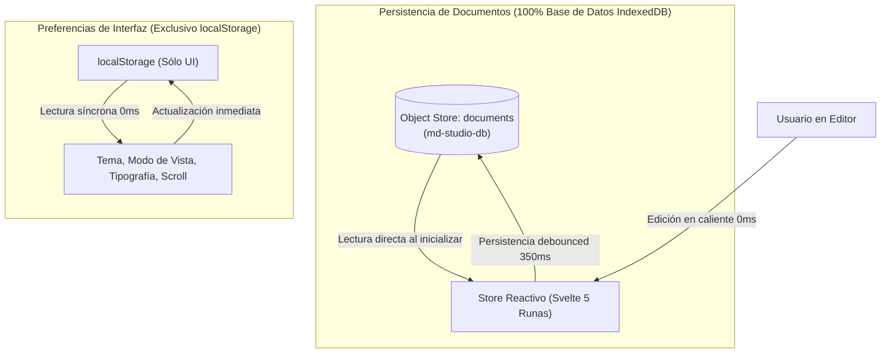

# MD Studio — Mesa de Lectura

> **MD Studio** es un entorno de escritura y lectura de Markdown de alto rendimiento, enfocado en la claridad tipográfica, la ausencia de distracciones, la soberanía de los datos del usuario y la experiencia visual tipo "Mesa de Lectura".

Construido con **Svelte 5** (Runas), **TypeScript**, **Vite** y **CodeMirror 6**, ofrece una arquitectura modular, reactiva y extensible que integra renderizado matemático con **KaTeX**, diagramas dinámicos con **Mermaid**, resaltado de sintaxis multi-lenguaje estilo VS Code, persistencia en **IndexedDB** y diseño responsivo adaptativo en 3 niveles (**Escritorio**, **Tablet** y **Móvil**).

---

## 🚀 Características Principales

### 1. Editor en Vivo con CodeMirror 6
- **Resaltado de sintaxis multi-lenguaje**: Soporte completo para bloques de código embebidos (`python`, `typescript`, `javascript`, `json`, `html`, `css`, `sql`, `bash`, `rust`, `go`, etc.) mediante `@codemirror/language-data`.
- **Tema ergonómico inspirado en VS Code**: Paleta de colores Dark+ y Light+ diseñada con contraste balanceado que previene la fatiga visual en sesiones prolongadas.
- **Minimapa vectorial de alta fidelidad**: Navegación rápida con visualización en bloques y conmutador para mostrar u ocultar.
- **Números de línea y plegado**: Gutters nativos alternables al instante sin redibujar el buffer.
- **Ajuste de línea (*Word Wrap*)**: Escritura y lectura fluida sin desbordamiento horizontal.

### 2. Visor de Lectura (*Preview*) Reactivo
- **Pipeline de renderizado seguro**: Conversión Markdown con **Marked** y sanitización estricta contra vulnerabilidades XSS mediante **DOMPurify**.
- **Fórmulas matemáticas KaTeX**: Soporte para ecuaciones en línea (`$E = mc^2$`) y en bloque (`$$\int f(x) dx$$`), protegidas antes del parseo para evitar colisiones sintácticas.
- **Diagramas Mermaid con zoom interactivo**: Generación de diagramas de flujo, secuencias, arquitectura, clases y estados con controles de ampliación individual (`+`, `−`, `↺`) y memoria caché por tema anti-parpadeo.
- **Resaltado de código con `highlight.js`**: Bloques de código con cabecera de lenguaje, tipografía `JetBrains Mono` y botón interactivo para copiar al portapapeles.
- **Tareas interactivas**: Checkboxes de tareas (`- [ ]` / `- [x]`) clickeables directamente en el visor de lectura que actualizan en caliente el Markdown fuente en el store.
- **Tablas responsivas**: Desplazamiento horizontal fluido (`overflow-x: auto`) para tablas anchas en pantallas reducidas.

### 3. Mesa de Lectura y Espacio de Trabajo
- **3 Modos de visualización**:
  - `Editor`: Máxima concentración en la escritura y código fuente.
  - `Dividido (Split)`: Edición y lectura simultánea con división 50/50 ajustable.
  - `Lectura (Preview)`: Mesa de lectura limpia y libre de distracciones sin paneles de edición.
- **Resizer interactivo**: Divisor arrastrable con restablecimiento instantáneo a 50/50 mediante doble clic.
- **Sincronización de scroll proporcional**: Desplazamiento bidireccional suave entre el editor CodeMirror y el visor de lectura.

### 4. Diseño Responsivo en 3 Niveles (Móvil, Tablet y Escritorio)
El sistema ajusta automáticamente la densidad de controles y la disposición del espacio de trabajo según el dispositivo:

- **Escritorio (`> 1024px`)**:
  - Barra de herramientas completa con accesos rápidos de formato Markdown (`Negrita`, `Cursiva`, `Título`, `Enlace`, `Tarea`, `Tabla`, `KaTeX`, `Mermaid`).
  - Selector completo de vistas (`Editor | Dividido | Lectura`).
  - Panel de herramientas directas: tamaño tipográfico, sincronización de scroll (`SYNC`), números de línea, minimapa, tema, guardado y PDF.
- **Tablet (`641px - 1024px`, ej. Surface Pro a 960px, iPad)**:
  - Barra superior limpia y espaciosa sin colisiones ni saturación de botones.
  - **Modo Dividido preservado**: Permite visualizar y editar lado a lado con el divisor interactivo.
  - Accesos de formato y herramientas secundarias agrupados elegantemente en el menú desplegable (`⋮`).
  - Botón de exportación `PDF` y selector de tema disponibles directamente en la barra.
- **Móvil (`≤ 640px`, smartphones)**:
  - Barra superior ultra-compacta con conmutador binario `Editor | Lectura` (el modo dividido se repliega para no comprimir ilegiblemente los paneles).
  - En pantallas de menos de `420px`, el conmutador muestra solo iconos compactos (`< >` y `👁️`).
  - Panel lateral (*Sidebar*) convertido en un cajón flotante (*drawer*) con fondo oscuro (*backdrop scrim*) y cierre automático táctil.
  - Menú desplegable (`⋮`) con exportación a PDF, descarga `.md`, grilla táctil de 8 accesos de formato y conmutadores de configuración.
  - Soporte para áreas seguras (`safe-area-inset`), altura dinámica `100dvh` y prevención de zoom accidental en inputs en iOS.

### 5. Persistencia Local con IndexedDB y Privacidad Total
- **Base de Datos Local Nativa (IndexedDB con `idb`)**: Todos los documentos se gestionan directamente y al 100% en la base de datos local del navegador mediante IndexedDB (`md-studio-db`), aprovechando la capacidad de almacenamiento ampliada del navegador sin restricciones de cuota ni dependencia de `localStorage`.
- **Sin migraciones desde `localStorage`**: No existen procesos de migración ni dependencia de documentos en `localStorage`. La persistencia, lectura y edición de documentos es exclusivamente por y para la base de datos local.
- **Arranque limpio desde cero (*Clean Slate*)**: Cualquier residuo o clave previa de documentos en el navegador se purga automáticamente al inicializar, garantizando un inicio completamente limpio desde la base de datos.
- **Escrituras en segundo plano debounced**: Las modificaciones se persisten con una pausa controlada de 350 ms para no bloquear el hilo de renderizado ni la escritura en CodeMirror.
- **Soberanía y privacidad**: Todo ocurre 100% en el cliente (*client-side*). Si se despliega en un servidor web público, cada usuario gestiona de forma aislada y privada sus propios documentos en su máquina; ningún dato viaja a servidores externos.

### 6. Exportación e Impresión Profesional
- **Descarga en Markdown**: Exportación directa del archivo activo como `.md`.
- **Exportación limpia a PDF**: Reglas optimizadas de `@media print` que ocultan controles interactivos, eliminan fondos superfluos y previenen saltos de página partidos en tablas, diagramas y bloques de código.

### 7. Sistema de Temas Atómico (0 ms)
- **Modos Oscuro y Claro**: Alternancia entre paletas ergonómicas diseñadas para lectura prolongada.
- **Sincronización instantánea**: Cambio atómico sin destellos ni desfases entre barra de herramientas, CodeMirror, visor de lectura y diagramas Mermaid.

---

## 🛠️ Stack Tecnológico

| Capa / Módulo | Tecnología | Versión | Propósito |
| :--- | :--- | :--- | :--- |
| **Framework** | [Svelte 5](https://svelte.dev/) | `^5.57.2` | Runas reactivas (`$state`, `$derived`, `$effect`) |
| **Lenguaje** | [TypeScript](https://www.typescriptlang.org/) | `~6.0.3` | Tipado estático estricto del dominio y componentes |
| **Bundler & Server** | [Vite](https://vite.dev/) | `^8.3.5` | HMR ultrarrápido y empaquetado optimizado |
| **Editor de Código** | [CodeMirror 6](https://codemirror.net/) | `^6.0.2` | Editor extensible y accesible |
| **Minimapa** | `@replit/codemirror-minimap` | `^0.5.2` | Navegación visual en el editor |
| **Base de Datos Local** | [idb](https://github.com/jakearchibald/idb) | `^8.0.4` | Wrapper con promesas para IndexedDB |
| **Motor Markdown** | [Marked](https://marked.js.org/) | `^18.1.2` | Parser de Markdown estándar y GFM |
| **Sanitización XSS** | [DOMPurify](https://github.com/cure53/DOMPurify) | `^3.4.17` | Prevención de inyecciones de código malicioso |
| **Sintaxis en Visor** | [highlight.js](https://highlightjs.org/) | `^11.12.0` | Resaltado de código estático con botones de copia |
| **Matemáticas** | [KaTeX](https://katex.org/) | `^0.19.1` | Renderizado LaTeX KaTeX rápido en bloque y en línea |
| **Diagramas** | [Mermaid](https://mermaid.js.org/) | `^12.2.0` | Diagramas de flujo, arquitectura y secuencias |
| **Iconografía** | [Lucide Svelte](https://lucide.dev/) | `^1.0.1` | Iconos vectoriales limpios y accesibles |

---

## 📁 Estructura del Proyecto

```text
md-studio/
├── index.html                   # Entrada HTML con viewport-fit=cover y metas móviles
├── package.json                 # Dependencias y scripts del proyecto
├── tsconfig.json                # Configuración base de TypeScript
├── tsconfig.app.json            # Configuración de compilación de la aplicación
├── vite.config.ts               # Configuración de Vite con plugin oficial de Svelte
└── src/
    ├── main.ts                  # Punto de montaje de la aplicación Svelte
    ├── app.css                  # Tokens de diseño, 100dvh, utilidades y reglas @media print
    ├── App.svelte               # Orquestador del espacio de trabajo, layout y atajos
    ├── types/
    │   └── index.ts             # Definición de interfaces (DocumentItem, Settings, etc.)
    ├── lib/
    │   └── db.ts                # Conexión, esquema y operaciones CRUD con IndexedDB
    ├── stores/
    │   └── documents.svelte.ts  # Store reactivo Svelte 5, debounce y sincronización
    └── components/
        ├── Editor.svelte        # Integración CodeMirror 6, temas VS Code y minimapa
        ├── Preview.svelte       # Pipeline Markdown, KaTeX, Mermaid y highlight.js
        ├── Toolbar.svelte       # Barra en 3 niveles, menú desplegable y snippets
        ├── Sidebar.svelte       # Drawer/panel de documentos, buscador, acciones y TOC
        ├── Resizer.svelte       # Divisor interactivo con doble clic para reset 50/50
        └── DropOverlay.svelte   # Overlay para arrastrar y soltar archivos Markdown
```

---

## 🔒 Arquitectura de Persistencia y Datos Locales

MD Studio implementa una arquitectura basada al 100% en base de datos local (**IndexedDB**) para el ciclo de vida completo de los documentos, eliminando cualquier migración o almacenamiento de documentos en `localStorage`:



### 1. Base de Datos IndexedDB (`md-studio-db`)
Toda la gestión de documentos se realiza directamente en la base de datos local del navegador:
- **Base de Datos**: `md-studio-db` (Versión 1)
- **Object Store**: `documents` (Clave primaria: `id`)
- **Campos**: `id`, `title`, `content`, `createdAt`, `updatedAt`
- **Gestión 100% en Base de Datos**: Creación, edición, guardado, listado y eliminación operan directamente contra IndexedDB mediante la biblioteca `idb`.
- **Sin migraciones desde `localStorage`**: No existen procesos de migración desde `localStorage` a la base de datos. Los documentos nunca se almacenan en `localStorage`. Cualquier clave residual o previa es purgada automáticamente en el arranque para garantizar un inicio limpio desde cero (*Clean Slate*).

### 2. Preferencias de Interfaz (`localStorage`)
`localStorage` se reserva **exclusivamente** para configuraciones cosméticas y de visualización de la interfaz de usuario:

| Clave `localStorage` | Propósito | Valores posibles / Tipo |
| :--- | :--- | :--- |
| `md_studio_theme_v1` | Tema de color activo | `'dark'` \| `'light'` |
| `md_studio_view_mode_v1` | Modo de visualización | `'editor'` \| `'split'` \| `'preview'` |
| `md_studio_font_size_v1` | Tamaño de tipografía de lectura | `'small'` \| `'medium'` \| `'large'` |
| `md_studio_sync_scroll_v1`| Sincronización de scroll | `'true'` \| `'false'` |
| `md_studio_line_numbers_v1`| Números de línea en editor | `'true'` \| `'false'` |
| `md_studio_minimap_v1` | Visibilidad del minimapa | `'true'` \| `'false'` |
| `md_studio_split_ratio_v1`| Proporción porcentual del divisor | `number` (ej. `50`) |
| `md_studio_active_id_v1` | Identificador del archivo activo | `string` (UUID) |

---

## ⌨️ Atajos de Teclado

| Atajo | Acción |
| :--- | :--- |
| <kbd>Ctrl</kbd> + <kbd>B</kbd> / <kbd>Cmd</kbd> + <kbd>B</kbd> | Alternar panel lateral (*Sidebar*) |
| <kbd>Ctrl</kbd> + <kbd>S</kbd> / <kbd>Cmd</kbd> + <kbd>S</kbd> | Forzar guardado con confirmación visual |
| <kbd>Ctrl</kbd> + <kbd>P</kbd> / <kbd>Cmd</kbd> + <kbd>P</kbd> | Abrir diálogo de exportación a PDF / Imprimir |
| <kbd>Tab</kbd> | Indentación con tabulación dentro del editor |
| Doble Clic en el divisor | Restablecer división de paneles al 50% / 50% |

---

## 📦 Instalación y Puesta en Marcha

### Prerrequisitos
- **Node.js** >= 18.0.0
- **npm** >= 9.0.0

### Pasos
1. Clona el repositorio o accede a la carpeta del proyecto:
   ```bash
   cd md-studio-svelte
   ```

2. Instala las dependencias del proyecto:
   ```bash
   npm install
   ```

3. Inicia el servidor de desarrollo local con recarga en caliente:
   ```bash
   npm run dev
   ```
   Abre tu navegador en `http://localhost:5173/`.

---

## 🧪 Verificación y Compilación

- **Comprobación estricta de tipos y componentes Svelte**:
  ```bash
  npm run check
  ```
- **Generación del bundle de producción optimizado**:
  ```bash
  npm run build
  ```
- **Previsualización local del bundle compilado**:
  ```bash
  npm run preview
  ```

---
