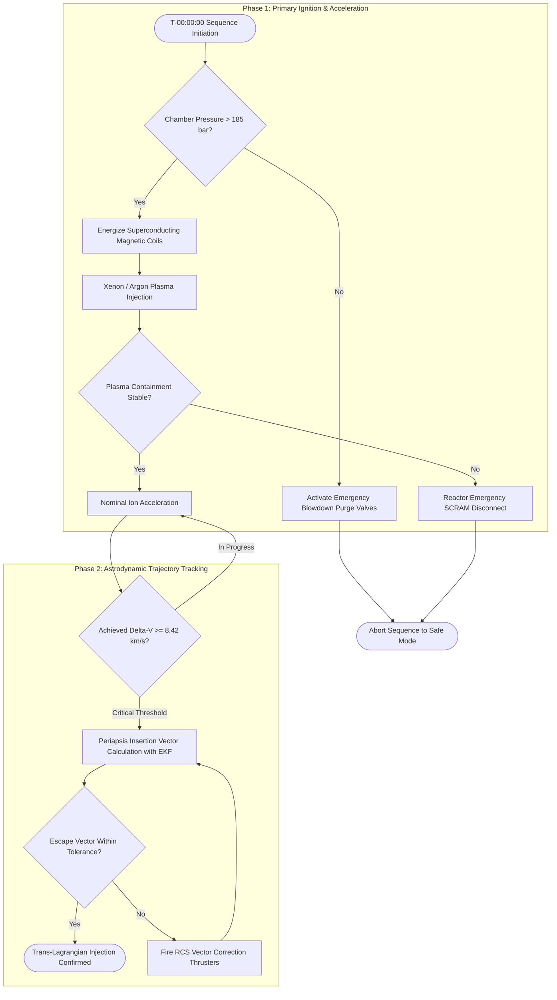
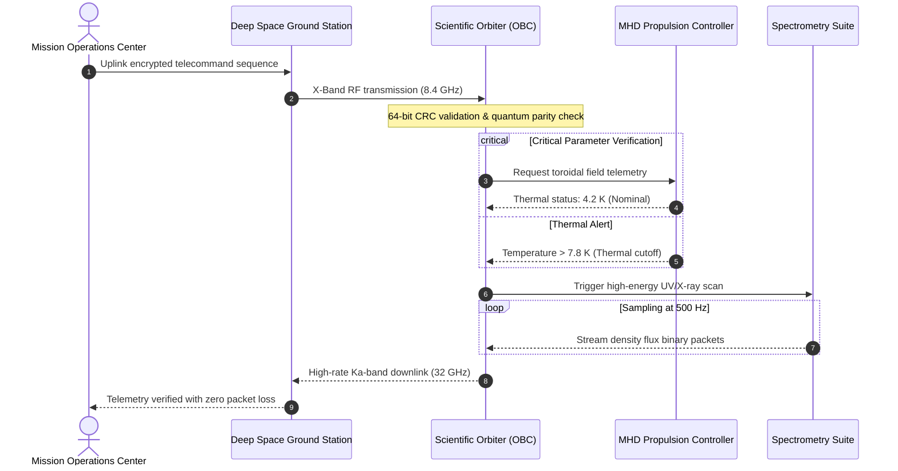
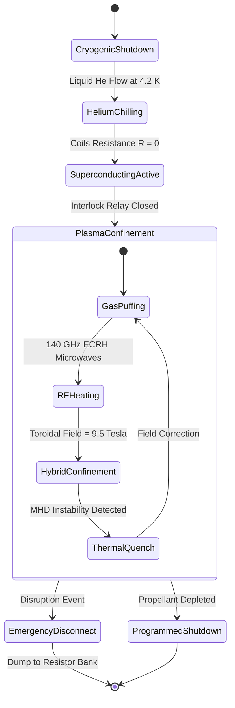

# ⚠️ [EXAMPLE / BENCHMARK] Astrodynamic Simulation & Magnetohydrodynamic (MHD) Propulsion

> [!WARNING] TECHNICAL BENCHMARK & UI STRESS TEST (SYNTHETIC EXAMPLE DATA)
> This technical document is an extreme stress-testing benchmark designed to validate Markdown rendering performance, $\LaTeX$ typography (KaTeX), Mermaid vector diagrams, and GFM extensions. All orbital models, relativistic tensors, physical constants, and telecommand sequences are synthetic demonstration formulations. **DO NOT take as operational flight data, engineering manuals, or literal scientific literature.**

---

## 1. Advanced Mathematical Notation & Tensor Formulations ($\LaTeX$ / KaTeX)

This section stress-tests the parser against dense inline and display math expressions, multi-level Greek symbols, differential operators, and legitimate escaped currency signs such as `\$128,450,000 USD` without breaking KaTeX delimiters.

### 1.1 Physical Parameters & Inline Microformats
The magnetic gradient drift velocity for a heavy-ion plasma beam is modeled by $\mathbf{v}_{\nabla B} = \frac{m v_\perp^2}{2 q B^3} (\mathbf{B} \times \nabla B)$, where the relativistic mass satisfies $m = \gamma m_0$ with Lorentz factor $\gamma = \left(1 - \frac{v^2}{c^2}\right)^{-1/2}$. The orbital resonant cyclotron frequency is given by $\Omega_c = \frac{q B}{m_0 \gamma}$, while the De Broglie wavelength of the stream is $\lambda_{\text{dB}} = \frac{h}{p} \approx 4.135 \times 10^{-15}\text{ eV}\cdot\text{s} / p$.

The cryogenic injection subsystem budget carries a projected cost of \$34,200,000 USD in primary hardware and \$12.50 USD per gram of purified xenon gas ($^{132}\text{Xe}$).

### 1.2 Coupled Magnetohydrodynamic (MHD) Transport Equations
The behavior of the ionized fluid within the convective magnetic nozzle obeys the non-linear Navier-Stokes system coupled with Maxwell's electrodynamic equations:

$$\begin{aligned}
\frac{\partial \rho}{\partial t} + \nabla \cdot (\rho \mathbf{v}) &= 0 \\
\rho \left( \frac{\partial \mathbf{v}}{\partial t} + (\mathbf{v} \cdot \nabla)\mathbf{v} \right) &= -\nabla p + \frac{1}{\mu_0} (\nabla \times \mathbf{B}) \times \mathbf{B} + \rho \mathbf{g} + \eta \nabla^2 \mathbf{v} \\
\frac{\partial \mathbf{B}}{\partial t} &= \nabla \times (\mathbf{v} \times \mathbf{B}) + \frac{\eta_m}{\mu_0} \nabla^2 \mathbf{B} \\
\rho C_v \left( \frac{\partial T}{\partial t} + \mathbf{v} \cdot \nabla T \right) &= -p (\nabla \cdot \mathbf{v}) + \nabla \cdot (k \nabla T) + \frac{\eta_m}{\mu_0^2} |\nabla \times \mathbf{B}|^2 + \Phi_{\text{visc}}
\end{aligned}$$

Where $\eta$ represents kinematic dynamic viscosity, $\eta_m = (\sigma_e \mu_0)^{-1}$ denotes magnetic diffusivity, and $\Phi_{\text{visc}}$ is the volumetric viscous dissipation tensor.

### 1.3 Lorentz Boost Tensor & Schwarzschild Metric
To correct for telemetry signal time dilation at the periapsis of a deep gravitational well:

$$ds^2 = -\left(1 - \frac{2GM}{r c^2}\right) c^2 dt^2 + \left(1 - \frac{2GM}{r c^2}\right)^{-1} dr^2 + r^2 (d\theta^2 + \sin^2\theta \, d\phi^2)$$

$$\mathbf{\Lambda}^\mu_{\phantom{\mu}\nu} = \begin{bmatrix}
\gamma & -\gamma \beta_x & -\gamma \beta_y & -\gamma \beta_z \\
-\gamma \beta_x & 1 + (\gamma - 1)\frac{\beta_x^2}{\beta^2} & (\gamma - 1)\frac{\beta_x \beta_y}{\beta^2} & (\gamma - 1)\frac{\beta_x \beta_z}{\beta^2} \\
-\gamma \beta_y & (\gamma - 1)\frac{\beta_y \beta_x}{\beta^2} & 1 + (\gamma - 1)\frac{\beta_y^2}{\beta^2} & (\gamma - 1)\frac{\beta_y \beta_z}{\beta^2} \\
-\gamma \beta_z & (\gamma - 1)\frac{\beta_z \beta_x}{\beta^2} & (\gamma - 1)\frac{\beta_z \beta_y}{\beta^2} & 1 + (\gamma - 1)\frac{\beta_z^2}{\beta^2}
\end{bmatrix}$$

---

## 2. High-Complexity Vector Diagrams (Mermaid SVG)

### 2.1 Flowchart: Orbital Insertion Algorithm & Contingency Safeguards



### 2.2 Sequence Diagram: Quantum Telemetry Protocol Architecture



### 2.3 State Diagram: Magnetic Confinement Lifecycle & Thermal Phases



---

## 3. Computational Navigation Algorithms & Thread Concurrency

### 3.1 4th-Order Runge-Kutta Orbital Integrator with J2 Perturbation (Python)

```python
import numpy as np
from typing import Tuple, Callable

# Standard Earth gravitational parameter (km^3 / s^2)
MU_EARTH: float = 398600.4418
J2_PERTURBATION: float = 1.08263e-3
EARTH_RADIUS_KM: float = 6378.137

def orbital_acceleration_j2(t: float, state: np.ndarray) -> np.ndarray:
    """Computes gravitational acceleration including J2 oblateness perturbation."""
    r_vec, v_vec = state[:3], state[3:]
    r = np.linalg.norm(r_vec)
    z2 = r_vec[2] ** 2
    r2 = r ** 2

    # Pure Newtonian spherical gravity
    a_newton = -MU_EARTH * r_vec / (r ** 3)

    # Zonal harmonic J2 perturbation
    factor_j2 = 1.5 * J2_PERTURBATION * MU_EARTH * (EARTH_RADIUS_KM ** 2) / (r ** 5)
    a_j2 = np.zeros(3)
    a_j2[0] = factor_j2 * r_vec[0] * (5.0 * z2 / r2 - 1.0)
    a_j2[1] = factor_j2 * r_vec[1] * (5.0 * z2 / r2 - 1.0)
    a_j2[2] = factor_j2 * r_vec[2] * (5.0 * z2 / r2 - 3.0)

    return np.concatenate([v_vec, a_newton + a_j2])

def integrate_rk4(deriv_fn: Callable, t0: float, y0: np.ndarray, dt: float, steps: int) -> np.ndarray:
    """Vectorized classical 4th-order Runge-Kutta numerical integrator."""
    trajectory = np.zeros((steps, len(y0)))
    trajectory[0] = y0
    y = y0.copy()
    t = t0

    for i in range(1, steps):
        k1 = deriv_fn(t, y)
        k2 = deriv_fn(t + 0.5 * dt, y + 0.5 * dt * k1)
        k3 = deriv_fn(t + 0.5 * dt, y + 0.5 * dt * k2)
        k4 = deriv_fn(t + dt, y + dt * k3)
        y += (dt / 6.0) * (k1 + 2.0 * k2 + 2.0 * k3 + k4)
        trajectory[i] = y
        t += dt

    return trajectory
```

### 3.2 Race-Free Concurrency Telemetry Ring Buffer (Rust)

```rust
use std::sync::{Arc, RwLock};
use std::time::SystemTime;

#[derive(Debug, Clone, Copy)]
pub struct PlasmaTelemetryFrame {
    pub timestamp_epoch_ms: u64,
    pub magnetic_field_tesla: f64,
    pub electron_density_m3: f64,
    pub ion_temperature_kev: f32,
    pub chamber_pressure_pa: f32,
}

pub struct TelemetryRingBuffer {
    buffer: Arc<RwLock<Vec<PlasmaTelemetryFrame>>>,
    capacity: usize,
}

impl TelemetryRingBuffer {
    pub fn new(capacity: usize) -> Self {
        Self {
            buffer: Arc::new(RwLock::new(Vec::with_capacity(capacity))),
            capacity,
        }
    }

    pub fn push(&self, frame: PlasmaTelemetryFrame) -> Result<(), &'static str> {
        let mut guard = self.buffer.write().map_err(|_| "Poisoned lock")?;
        if guard.len() >= self.capacity {
            guard.remove(0); // Evict oldest telemetry frame
        }
        guard.push(frame);
        Ok(())
    }
}
```

---

## 4. Dense GFM Scientific Benchmark Table with Alignments

| Mission ID | Target Trajectory | Propulsion Suite | Theoretical $\Delta v$ (km/s) | Radiative Flux ($\text{kW/m}^2$) | Flight Status | Telemetry Log |
| :--- | :--- | :---: | ---: | :---: | :---: | :--- |
| **ORB-LEO-01** | Low Earth Orbit ($h = 420\text{ km}$) | Hall Effect ($\text{Xe}$) | `3.42` | $1.36$ | Active | [LEO Telemetry](#) |
| **MHD-DEEP-04**| Selenite Lagrangian Point $L_1$ | Pulsed MHD ($^3\text{He}$) | `14.85` | $8.92$ | Calibrating | [$L_1$ Logstream](#) |
| **SOL-GRAV-09**| Jupiter Gravity Assist Slingshot | Direct Fusion ($\text{D}-\text{T}$) | `28.60` | $42.10$ | Simulating | [Manifest](#) |
| **KUI-ESC-12** | Solar System Escape ($v_\infty$) | Magnetic Cusp Ion | `62.15` | $0.24$ | Planning | [Ephemeris](#) |

---

## 5. GFM Alerts & Admonition Blocks

> [!NOTE]
> The vacuum permeability constant is defined in SI units as $\mu_0 = 4\pi \times 10^{-7}\text{ H/m} \approx 1.256637 \times 10^{-6}\text{ N/A}^2$.

> [!TIP]
> Utilize an asymmetric gradient magnetic nozzle to convert up to $88\%$ of transverse thermal plasma energy into direct axial thrust.

> [!IMPORTANT]
> All commanding packets routed to the propulsion controller require ED25519 cryptographic signatures before passing validation on the CAN bus.

> [!WARNING]
> Magnetohydrodynamic resonance near the ion cyclotron frequency may excite non-linear *Kink* instabilities across the plasma column.

> [!CAUTION]
> Never shut down the redundant helium cryogenic cooling loop while the residual current in the superconducting solenoid exceeds $120\text{ A}$.

---

## 6. Operational Checklist & Hierarchical Checkboxes

- [x] Cryogenic heat shield thermal soak verified at $4.2\text{ K}$
- [x] Buffer gas injection of $99.999\%$ ultra-pure Argon completed
- [ ] Reaction propellant tank pressurization sequence
  - [x] Tank Alpha ($^3\text{He}$) nominal at $400\text{ bar}$
  - [x] Tank Beta ($\text{D}_2$) nominal at $400\text{ bar}$
  - [ ] High-speed piezoelectric valve leak-rate checkout
- [ ] Radiofrequency (RF) pulse timing synchronized with magnetic field sensors
- [ ] Final launch authorization granted by Range Safety Officer

---

## 7. Collapsible Telemetry Modules (`<details>`)

<details>
<summary><b>🔍 Expand to inspect Extended Kalman Filter (EKF) Covariance Matrix</b></summary>

During orbital state estimation, the error covariance matrix $\mathbf{P}_k \in \mathbb{R}^{6 \times 6}$ propagates between discrete measurements as:

$$\mathbf{P}_{k|k-1} = \mathbf{F}_k \mathbf{P}_{k-1|k-1} \mathbf{F}_k^T + \mathbf{Q}_k$$

```text
Process Noise Parameters:
- Position Variance (Sigma R): 1.5e-4 km^2
- Velocity Variance (Sigma V): 3.2e-7 km^2/s^2
- Atomic Oscillator Clock Drift: 1.0e-12 s/s
```

</details>

<details>
<summary><b>🛠️ View Radiation-Tolerant On-Board Computer (OBC) Hardware Specs</b></summary>

* **Processing Architecture**: Rad-Hardened Quad-Core SPARC V8 (LEON4) clocked at $150\text{ MHz}$
* **Primary Memory**: $4\text{ GB}$ ECC SDRAM with Triple Modular Redundancy (TMR)
* **Bus Interfaces**: 4 independent SpaceWire links at $200\text{ Mbps}$ and dual MIL-STD-1553B bus
* **Total Ionizing Dose (TID) Tolerance**: $> 300\text{ krad(Si)}$

</details>

---

## 8. Semantic Footnotes & References

[^1]: Synthetic citation generated solely for typographic and bidirectional link verification within Markdown Studio.

