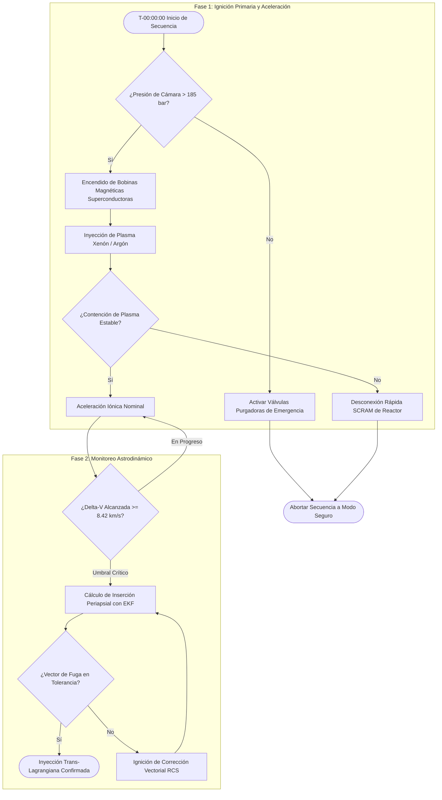
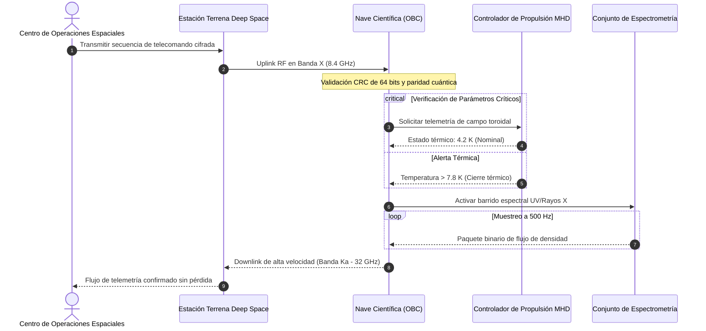
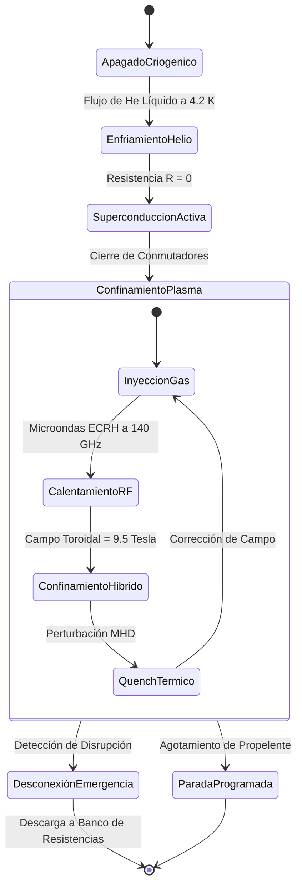

# ⚠️ [EJEMPLO / BENCHMARK] Simulación Astrodinámica y Propulsión Magnetohidrodinámica (MHD)

> [!WARNING] DOCUMENTO DE PRUEBA TÉCNICA Y ESTRÉS DE UI (DATOS SINTÉTICOS DE EJEMPLO)
> Este documento técnico es un banco de pruebas de estrés extremo diseñado para validar el rendimiento del motor Markdown, la tipografía matemática $\LaTeX$ (KaTeX), los diagramas vectoriales Mermaid y las extensiones GFM. Todos los modelos orbitales, tensores relativistas, constantes físicas y secuencias de telecomando son formulaciones sintéticas de demostración. **NO tomar como literatura operativa, manual de vuelo ni datos científicos literales.**

---

## 1. Notación Matemática Avanzada y Formulación Tensorial ($\LaTeX$ / KaTeX)

En este bloque se comprueba la resistencia del parser ante expresiones matemáticas densas en línea y en bloque, caracteres griegos multinivel, operadores diferenciales y el uso legítimo de signos de moneda escapados como `\$128,450,000 USD` sin interferir con las ecuaciones.

### 1.1 Parámetros Físicos y Microformatos en Línea
La velocidad de deriva por gradiente de campo magnético para un plasma de iones pesados se modela mediante $\mathbf{v}_{\nabla B} = \frac{m v_\perp^2}{2 q B^3} (\mathbf{B} \times \nabla B)$, donde la masa relativista satisface $m = \gamma m_0$ con el factor de Lorentz $\gamma = \left(1 - \frac{v^2}{c^2}\right)^{-1/2}$. La frecuencia ciclotrónica orbital de resonancia viene dada por $\Omega_c = \frac{q B}{m_0 \gamma}$, mientras que la longitud de onda de De Broglie del flujo es $\lambda_{\text{dB}} = \frac{h}{p} \approx 4.135 \times 10^{-15}\text{ eV}\cdot\text{s} / p$.

El presupuesto del subsistema criogénico de inyección asciende a un costo proyectado de \$34,200,000 USD en hardware primario y \$12.50 USD por gramo de xenón purificado ($^{132}\text{Xe}$).

### 1.2 Ecuaciones de Transporte Magnetohidrodinámico (MHD) Acopladas
El comportamiento del fluido ionizado en el interior de la tobera magnética convectiva se rige por el sistema no lineal de Navier-Stokes acoplado a las ecuaciones de Maxwell:

$$\begin{aligned}
\frac{\partial \rho}{\partial t} + \nabla \cdot (\rho \mathbf{v}) &= 0 \\
\rho \left( \frac{\partial \mathbf{v}}{\partial t} + (\mathbf{v} \cdot \nabla)\mathbf{v} \right) &= -\nabla p + \frac{1}{\mu_0} (\nabla \times \mathbf{B}) \times \mathbf{B} + \rho \mathbf{g} + \eta \nabla^2 \mathbf{v} \\
\frac{\partial \mathbf{B}}{\partial t} &= \nabla \times (\mathbf{v} \times \mathbf{B}) + \frac{\eta_m}{\mu_0} \nabla^2 \mathbf{B} \\
\rho C_v \left( \frac{\partial T}{\partial t} + \mathbf{v} \cdot \nabla T \right) &= -p (\nabla \cdot \mathbf{v}) + \nabla \cdot (k \nabla T) + \frac{\eta_m}{\mu_0^2} |\nabla \times \mathbf{B}|^2 + \Phi_{\text{visc}}
\end{aligned}$$

Donde $\eta$ es la viscosidad dinámica cinemática, $\eta_m = (\sigma_e \mu_0)^{-1}$ representa la difusividad magnética y $\Phi_{\text{visc}}$ es el tensor de disipación viscosa volumétrica.

### 1.3 Transformación Tensorial de Lorentz y Métrica de Schwarzschild
Para corregir la dilatación temporal de las señales de telemetría en el periapsis de un pozo gravitatorio profundo:

$$ds^2 = -\left(1 - \frac{2GM}{r c^2}\right) c^2 dt^2 + \left(1 - \frac{2GM}{r c^2}\right)^{-1} dr^2 + r^2 (d\theta^2 + \sin^2\theta \, d\phi^2)$$

$$\mathbf{\Lambda}^\mu_{\phantom{\mu}\nu} = \begin{bmatrix}
\gamma & -\gamma \beta_x & -\gamma \beta_y & -\gamma \beta_z \\
-\gamma \beta_x & 1 + (\gamma - 1)\frac{\beta_x^2}{\beta^2} & (\gamma - 1)\frac{\beta_x \beta_y}{\beta^2} & (\gamma - 1)\frac{\beta_x \beta_z}{\beta^2} \\
-\gamma \beta_y & (\gamma - 1)\frac{\beta_y \beta_x}{\beta^2} & 1 + (\gamma - 1)\frac{\beta_y^2}{\beta^2} & (\gamma - 1)\frac{\beta_y \beta_z}{\beta^2} \\
-\gamma \beta_z & (\gamma - 1)\frac{\beta_z \beta_x}{\beta^2} & (\gamma - 1)\frac{\beta_z \beta_y}{\beta^2} & 1 + (\gamma - 1)\frac{\beta_z^2}{\beta^2}
\end{bmatrix}$$

---

## 2. Diagramas Vectoriales de Alta Complejidad (Mermaid SVG)

### 2.1 Diagrama de Flujo: Algoritmo de Inserción Orbital y Control de Contingencia



### 2.2 Diagrama de Secuencia: Arquitectura de Telecomando Cuántico



### 2.3 Máquina de Estados: Ciclo de Operación del Confinamiento Magnético



---

## 3. Algoritmos Computacionales de Navegación y Concurrencia

### 3.1 Integrador Numérico Orbital Runge-Kutta de 4to Orden (Python)

```python
import numpy as np
from typing import Tuple, Callable

# Constante gravitacional terrestre estándar (km^3 / s^2)
MU_EARTH: float = 398600.4418
J2_PERTURBATION: float = 1.08263e-3
EARTH_RADIUS_KM: float = 6378.137

def orbital_acceleration_j2(t: float, state: np.ndarray) -> np.ndarray:
    """Calcula las aceleraciones gravitatorias incluyendo la perturbación zonal J2."""
    r_vec, v_vec = state[:3], state[3:]
    r = np.linalg.norm(r_vec)
    z2 = r_vec[2] ** 2
    r2 = r ** 2

    # Aceleración Newtoniana pura
    a_newton = -MU_EARTH * r_vec / (r ** 3)

    # Perturbación oblata zonal J2
    factor_j2 = 1.5 * J2_PERTURBATION * MU_EARTH * (EARTH_RADIUS_KM ** 2) / (r ** 5)
    a_j2 = np.zeros(3)
    a_j2[0] = factor_j2 * r_vec[0] * (5.0 * z2 / r2 - 1.0)
    a_j2[1] = factor_j2 * r_vec[1] * (5.0 * z2 / r2 - 1.0)
    a_j2[2] = factor_j2 * r_vec[2] * (5.0 * z2 / r2 - 3.0)

    return np.concatenate([v_vec, a_newton + a_j2])

def integrate_rk4(deriv_fn: Callable, t0: float, y0: np.ndarray, dt: float, steps: int) -> np.ndarray:
    """Integrador RK4 vectorial sin dependencias de paquetes externos."""
    trajectory = np.zeros((steps, len(y0)))
    trajectory[0] = y0
    y = y0.copy()
    t = t0

    for i in range(1, steps):
        k1 = deriv_fn(t, y)
        k2 = deriv_fn(t + 0.5 * dt, y + 0.5 * dt * k1)
        k3 = deriv_fn(t + 0.5 * dt, y + 0.5 * dt * k2)
        k4 = deriv_fn(t + dt, y + dt * k3)
        y += (dt / 6.0) * (k1 + 2.0 * k2 + 2.0 * k3 + k4)
        trajectory[i] = y
        t += dt

    return trajectory
```

### 3.2 Buffer de Telemetría Seguro contra Condiciones de Carrera (Rust)

```rust
use std::sync::{Arc, RwLock};
use std::time::SystemTime;

#[derive(Debug, Clone, Copy)]
pub struct PlasmaTelemetryFrame {
    pub timestamp_epoch_ms: u64,
    pub magnetic_field_tesla: f64,
    pub electron_density_m3: f64,
    pub ion_temperature_kev: f32,
    pub chamber_pressure_pa: f32,
}

pub struct TelemetryRingBuffer {
    buffer: Arc<RwLock<Vec<PlasmaTelemetryFrame>>>,
    capacity: usize,
}

impl TelemetryRingBuffer {
    pub fn new(capacity: usize) -> Self {
        Self {
            buffer: Arc::new(RwLock::new(Vec::with_capacity(capacity))),
            capacity,
        }
    }

    pub fn push(&self, frame: PlasmaTelemetryFrame) -> Result<(), &'static str> {
        let mut guard = self.buffer.write().map_err(|_| "Bloqueo envenenado")?;
        if guard.len() >= self.capacity {
            guard.remove(0); // Evict oldest frame
        }
        guard.push(frame);
        Ok(())
    }
}
```

---

## 4. Banco de Pruebas de Tablas GFM Densas con Alineación

| Identificador | Trayectoria Objetivo | Sistema Propulsor | $\Delta v$ Nominal (km/s) | Flujo Radiativo ($\text{kW/m}^2$) | Estado Operativo | Registro Técnico |
| :--- | :--- | :---: | ---: | :---: | :---: | :--- |
| **ORB-LEO-01** | Órbita Baja Terrestre ($h = 420\text{ km}$) | Hall Effect ($\text{Xe}$) | `3.42` | $1.36$ | Activo | [Registro LEO](#) |
| **MHD-DEEP-04**| Punto Lagrangiano Selenita $L_1$ | MHD Pulsado ($^3\text{He}$) | `14.85` | $8.92$ | Calibración | [Telemetría $L_1$](#) |
| **SOL-GRAV-09**| Asistencia Gravitacional de Júpiter | Fusión Directa ($\text{D}-\text{T}$) | `28.60` | $42.10$ | Simulación | [Manifiesto](#) |
| **KUI-ESC-12** | Escape del Sistema Solar ($v_\infty$) | Iónico Cusp Magnético | `62.15` | $0.24$ | Planificación | [Efemérides](#) |

---

## 5. Alertas GFM y Admoniciones Visuales

> [!NOTE]
> La constante de permeabilidad del vacío está definida en el SI como $\mu_0 = 4\pi \times 10^{-7}\text{ H/m} \approx 1.256637 \times 10^{-6}\text{ N/A}^2$.

> [!TIP]
> Emplee una tobera magnética con gradiente asimétrico para reconvertir hasta un $88\%$ de la energía térmica transversal en empuje axial directo.

> [!IMPORTANT]
> Todos los paquetes de comando transmitidos al subsistema de propulsión requieren firma criptográfica ED25519 antes de ser admitidos en el bus CAN.

> [!WARNING]
> La resonancia magnetohidrodinámica en frecuencias cercanas a la deriva ciclotrónica puede provocar inestabilidades de tipo *Kink* en el plasma.

> [!CAUTION]
> No desactive el sistema criogénico redundante de helio si la corriente residual del solenoide superconductor supera los $120\text{ A}$.

---

## 6. Listas de Verificación Operativa y Checkboxes Anidados

- [x] Calibración criogénica del blindaje térmico a $4.2\text{ K}$ completada
- [x] Inyección de gas buffer de argón puro al $99.999\%$
- [ ] Secuencia de presurización de tanques de reacción
  - [x] Tanque Alfa ($^3\text{He}$) verificado a $400\text{ bar}$
  - [x] Tanque Beta ($\text{D}_2$) verificado a $400\text{ bar}$
  - [ ] Prueba de fuga en válvulas piezoeléctricas de alta velocidad
- [ ] Sincronización de pulsos de radiofrecuencia (RF) con los sensores magnéticos
- [ ] Autorización de lanzamiento por parte del oficial de seguridad de vuelo

---

## 7. Módulos Plegables y Desglose de Telemetría (`<details>`)

<details>
<summary><b>🔍 Expandir para ver la Matriz de Covarianza del Filtro de Kalman Extendido (EKF)</b></summary>

En la estimación de estado orbital, la matriz de covarianza de error $\mathbf{P}_k \in \mathbb{R}^{6 \times 6}$ se propaga entre épocas de muestreo según:

$$\mathbf{P}_{k|k-1} = \mathbf{F}_k \mathbf{P}_{k-1|k-1} \mathbf{F}_k^T + \mathbf{Q}_k$$

```text
Configuración de Ruido de Proceso:
- Varianza en posición (Sigma R): 1.5e-4 km^2
- Varianza en velocidad (Sigma V): 3.2e-7 km^2/s^2
- Ruido de reloj del oscilador atómico: 1.0e-12 s/s
```

</details>

<details>
<summary><b>🛠️ Ver especificaciones de hardware de la Unidad Central de Navegación</b></summary>

* **Arquitectura de Procesamiento**: Rad-Hardened Quad-Core SPARC V8 (LEON4) a $150\text{ MHz}$
* **Memoria Primaria**: $4\text{ GB}$ SDRAM con corrección de errores triple modular redundante (TMR)
* **Conectividad de Bus**: 4 canales independientes SpaceWire a $200\text{ Mbps}$ y bus dual MIL-STD-1553B
* **Tolerancia a Dosis Ionizante Total**: $> 300\text{ krad(Si)}$

</details>

---

## 8. Notas al Pie Semánticas y Referencias

[^1]: Cita ficticia generada exclusivamente para la validación tipográfica y de navegación bidireccional en Markdown Studio.

