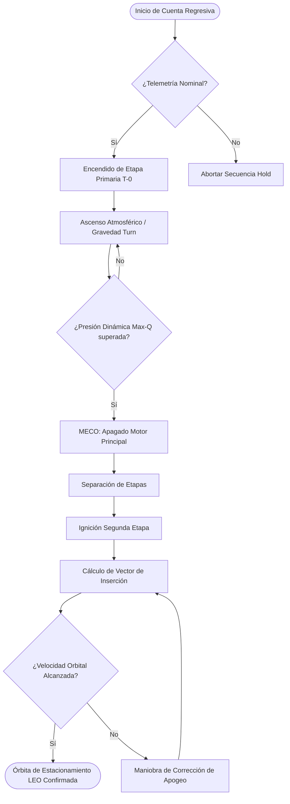
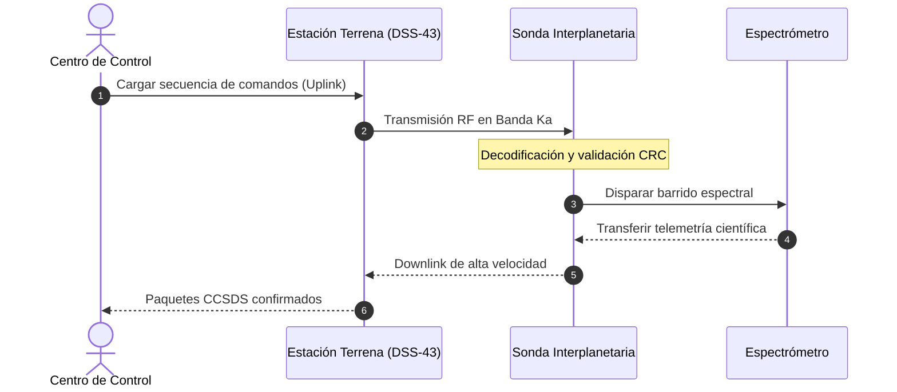
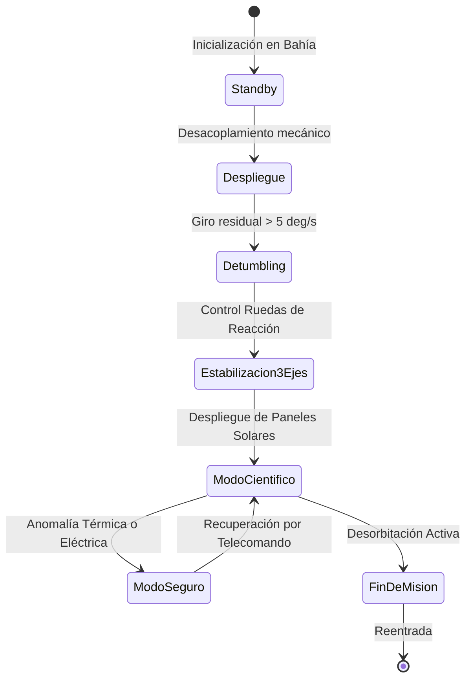

# 🚀 Manual de Astrodinámica y Simulación Orbital (Markdown Benchmark)

Documento técnico de prueba diseñado para validar motores de renderizado Markdown, extensiones **GFM** (*GitHub Flavored Markdown*), soporte de $\LaTeX$, diagramas vectoriales y microformatos interactivos.

---

## 1. Tipografía y Estilos de Texto

En este bloque validamos las variantes tipográficas básicas y avanzadas del parser:

* **Texto en negrita** con doble asterisco o __doble guion bajo__.
* *Texto en cursiva* con un asterisco o _un guion bajo_.
* ***Texto en negrita y cursiva combinada***.
* ~~Texto tachado para elementos obsoletos o cancelados~~.
* Texto con `código inline` para variables como `delta_v` o `mu_earth`.
* Combinaciones con HTML semántico:
  * Superíndice: $r^2$ o mediante etiqueta $r$<sup>2</sup>
  * Subíndice: $\text{H}_2\text{O}$ o mediante etiqueta H<sub>2</sub>O
  * Abreviatura: <abbr title="National Aeronautics and Space Administration">NASA</abbr>
  * Teclas de atajo: presione <kbd>Ctrl</kbd> + <kbd>Shift</kbd> + <kbd>R</kbd> para recalcular la trayectoria.
  * Resaltado tipográfico: <mark>Alerta de reentrada atmosférica</mark>.

---

## 2. Ecuaciones Matemáticas en $\LaTeX$

El motor debe renderizar notaciones matemáticas tanto en bloque (display mode) como en línea (inline mode).

### 2.1 Ecuaciones en línea
La velocidad orbital circular viene dada por $v_c = \sqrt{\frac{G M}{r}}$, donde $G$ representa la constante gravitacional universal, $M$ la masa del cuerpo primario y $r$ la distancia radial. El período orbital se expresa como $T = 2\pi \sqrt{\frac{a^3}{\mu}}$, cumpliendo con la tercera ley de Kepler.

### 2.2 Ecuaciones en bloque (Display Math)

#### Ecuación del Cohete de Tsiolkovsky
La variación total de velocidad ($\Delta v$) requerida para una maniobra impulsiva es:

$$\Delta v = I_{\text{sp}} \cdot g_0 \cdot \ln\left(\frac{m_0}{m_f}\right)$$

Donde:
* $I_{\text{sp}}$ es el impulso específico (en segundos).
* $g_0$ es la aceleración gravitatoria estándar ($9.80665 \text{ m/s}^2$).
* $m_0$ es la masa inicial total húmeda.
* $m_f$ es la masa final seca tras la combustión.

#### Transferencia Bi-elíptica de Hohmann
Para calcular la energía específica orbital ($\varepsilon$) en una cónica perturbada:

$$\varepsilon = \frac{v^2}{2} - \frac{\mu}{r} = -\frac{\mu}{2a}$$

$$\Delta v_{\text{total}} = \sqrt{\frac{\mu}{r_1}} \left( \sqrt{\frac{2 r_2}{r_1 + r_2}} - 1 \right) + \sqrt{\frac{\mu}{r_2}} \left( 1 - \sqrt{\frac{2 r_1}{r_1 + r_2}} \right)$$

#### Representación Matricial de Maniobras de Actitud (Ángulos de Euler)
Transformación de coordenadas entre el sistema inercial ECI (*Earth-Centered Inertial*) y el marco nodal LVLH:

$$\mathbf{R}(\psi, \theta, \phi) = \begin{bmatrix}
\cos\theta\cos\psi & \cos\theta\sin\psi & -\sin\theta \\
\sin\phi\sin\theta\cos\psi - \cos\phi\sin\psi & \sin\phi\sin\theta\sin\psi + \cos\phi\cos\psi & \sin\phi\cos\theta \\
\cos\phi\sin\theta\cos\psi + \sin\phi\sin\psi & \cos\phi\sin\theta\sin\psi - \sin\phi\cos\psi & \cos\phi\cos\theta
\end{bmatrix}$$

---

## 3. Diagramas Mermaid

### 3.1 Diagrama de Flujo (Algoritmo de Inserción Orbital)



### 3.2 Diagrama de Secuencia (Comunicaciones Satelitales)



### 3.3 Diagrama de Estados (Fases de Vuelo de la Carga Útil)



---

## 4. Listas de Control y Tareas (Checkboxes)

### 4.1 Verificación Pre-Vuelo (L-24 Horas)
- [x] Carga de combustible criogénico ($\text{LOX} / \text{LH}_2$) completada
- [x] Calibración giroscópica de la unidad de medición inercial (IMU)
- [x] Comprobación de redundancia de bus CAN y enlace MIL-STD-1553
- [ ] Presurización de helio en tanques auxiliares
  - [x] Tanque Alfa a 350 bar
  - [ ] Tanque Beta a 350 bar (verificación pendiente)
- [ ] Autorización final de control de rango (Range Safety Officer)
- [ ] Cierre de compuertas de servicio en torre umbilicar

---

## 5. Bloques de Código con Resaltado de Sintaxis

### 5.1 Python: Cálculo de Parámetros Orbitales de Kepler

```python
import math
from typing import NamedTuple

class OrbitalElements(NamedTuple):
    semi_major_axis: float  # km
    eccentricity: float
    inclination: float      # deg

def compute_orbital_period(elements: OrbitalElements, mu: float = 398600.4418) -> float:
    """Calcula el periodo orbital en segundos usando la 3ra ley de Kepler."""
    if elements.eccentricity < 0.0 or elements.eccentricity >= 1.0:
        raise ValueError("La órbita debe ser elíptica o circular (0 <= e < 1).")
    
    a_meters = elements.semi_major_axis * 1000.0
    mu_standard = mu * 1e9  # Convertir a m^3 / s^2
    
    period = 2.0 * math.pi * math.sqrt((a_meters ** 3) / mu_standard)
    return period

# Instanciar órbita tipo ISS (Estación Espacial Internacional)
iss_orbit = OrbitalElements(semi_major_axis=6798.0, eccentricity=0.0006, inclination=51.64)
print(f"Periodo Orbital ISS: {compute_orbital_period(iss_orbit) / 60.0:.2f} minutos")
```

### 5.2 JSON: Manifiesto de Telecomando CCSDS

```json
{
  "header": {
    "version": 1,
    "packet_type": "TELECOMMAND",
    "secondary_header_flag": true,
    "apid": 412,
    "sequence_count": 1842
  },
  "payload": {
    "subsystem": "PROPULSION",
    "burn_duration_seconds": 14.25,
    "target_vector": {
      "vx": 12.45,
      "vy": -0.82,
      "vz": 3.11
    },
    "checksum": "0xA8F4"
  }
}
```

### 5.3 Bash: Automatización de Pruebas de Telemetría

```bash
#!/usr/bin/env bash
set -euo pipefail

TARGET_NODE="sat-gateway-primary.space.local"
PORT=8080

echo "Iniciando barrido de puertos sobre ${TARGET_NODE}..."
if nc -zvw3 "${TARGET_NODE}" "${PORT}"; then
    echo "[OK] Nodo accesible. Iniciando ingesta de paquetes UDP..."
    socat -u UDP-RECV:9000,bind=0.0.0.0 FILE:telemetry_stream.bin,create &
else
    echo "[ERROR] Conexión rechazada por el transceptor." >&2
    exit 1
fi
```

---

## 6. Tablas con Alineaciones y Formato Complejo

| ID Misión | Destino Primario | Tipo de Propulsión | $\Delta v$ Presupuestada (km/s) | Estado Operativo | Enlace de Monitoreo |
| :--- | :---: | :--- | ---: | :---: | :---: |
| **ORB-01** | Órbita LEO | Química Bipropelente | `3.20` | Activa | [Telemetría](#) |
| **GEO-07** | GEO Síncrona | Iónica Hall ($\text{Xe}$) | `1.85` | En Espera | [Diagnóstico](#) |
| **LUN-03** | LLO (Lunar) | Metano / Oxígeno | `4.60` | Planificación | [Simulación](#) |
| **DS-09** | Punto Lagrangiano $L_2$ | Vela Solar + Gridded Ion | `0.42` | Calibración | [Datos $L_2$](#) |

---

## 7. Citas en Bloque y Alertas de Estilo GFM

> "No hay nada más fascinante que trazar un camino entre las estrellas sabiendo que cada gramo de masa cuenta contra la gravedad del mundo que dejas atrás."
>
> — *Dr. Elena Morales, Directora de Navegación Interplanetaria*[^1]

### Bloques de Citas Anidados

> **Nivel de Jerarquía 1**: Análisis de contingencia de trayectoria.
> > **Nivel de Jerarquía 2**: Fallo en la tobera secundaria.
> > > **Acción Inmediata**: Reconfigurar empuje diferencial y conmutar a propulsores de gas frío RCS.

### Alertas GFM (Callouts / Blockquotes Admonitions)

> [!NOTE]
> La constante gravitacional estándar $\mu = GM$ para la Tierra tiene un valor aproximado de $398600.4418\text{ km}^3/\text{s}^2$.

> [!TIP]
> Emplee una asistencia gravitatoria con Júpiter para reducir el consumo total de propelente en misiones hacia el Cinturón de Kuiper.

> [!WARNING]
> La degradación por radiación en los anillos de Van Allen puede causar *Single Event Upsets* (SEU) en módulos de memoria no protegidos.

> [!CAUTION]
> No ejecute la maniobra de inserción periapsial sin confirmar la orientación de los escudos térmicos ablativos.

---

## 8. Listas Complejas (Ordenadas, No Ordenadas y Mixtas)

1. **Fase de Inyección Trans-Mars (TMI)**
   * Comprobación de ángulo de fase planetaria
     * Ventana de lanzamiento: 14 días
     * Inclinación heliocéntrica $\le 1.85^\circ$
   * Ignición principal:
     1. Pre-acondicionamiento criogénico (chilldown)
     2. Secuencia de encendido en rampa
     3. Apagado por corte de acelerómetro
2. **Crucero Interplanetario**
   * Maniobras de Corrección de Trayectoria (TCM):
     * [x] TCM-1: Corrección de dispersión del vector lanzador
     * [ ] TCM-2: Ajuste de tiempo de llegada al plano B
     * [ ] TCM-3: Alineación fina de entrada atmosférica
3. **Fase Terminal y Descenso (EDL)**
   * Reentrada hipersónica a $ Mach \approx 25 $
   * Despliegue de paracaídas supersónico
   * Retropropulsión final mediante grúa aérea (*Sky Crane*)

---

## 9. Contenido Desplegable (HTML5 Details / Accordion)

<details>
<summary><b>🔍 Expandir para ver la Matriz de Covarianza del Filtro de Kalman (EKF)</b></summary>

En el filtrado de navegación orbital, el vector de estado estimado $\mathbf{x}_k = [r_x, r_y, r_z, v_x, v_y, v_z]^T$ propaga la incertidumbre según:

$$\mathbf{P}_{k|k-1} = \mathbf{\Phi}_{k,k-1} \mathbf{P}_{k-1|k-1} \mathbf{\Phi}_{k,k-1}^T + \mathbf{Q}_{k-1}$$

```
Parámetros de Ruido del Sensor Estelar:
- Ruido Blanco Gaúcho (Sigma): 2.5 arcosegundos
- Sesgo de Deriva Térmica: 0.05 arcsec/hora
- Frecuencia de Actualización: 10 Hz
```

</details>

<details>
<summary><b>🛠️ Ver especificaciones de hardware del ordenador de a bordo (OBC)</b></summary>

* **Procesador**: Rad-Hardened Quad-Core SPARC V8 (LEON4) a 150 MHz
* **Memoria**: 4 GB ECC SDRAM tolerante a radiación (TMR)
* **Almacenamiento masivo**: 512 GB SLC NAND Flash con nivelación de desgaste
* **Sistema Operativo**: RTEMS en tiempo real determinista

</details>

---

## 10. Referencias, Enlaces e Imágenes

* Documento normativo oficial: [CCSDS Standards Publications](https://public.ccsds.org/)
* Repositorio de efemérides planetarias: [JPL Horizons System](https://ssd.jpl.nasa.gov/horizons/)
* Enlace de anclaje relativo: Ir a [Ecuaciones en bloque](#22-ecuaciones-en-bloque-display-math)

### Imagen de Prueba con Texto Alternativo


---

## 11. Notas al Pie de Página

[^1]: Cita ficticia extraída de los *Anales de la Sociedad de Exploración del Espacio Profundo*, Volumen XLII, 2026.

